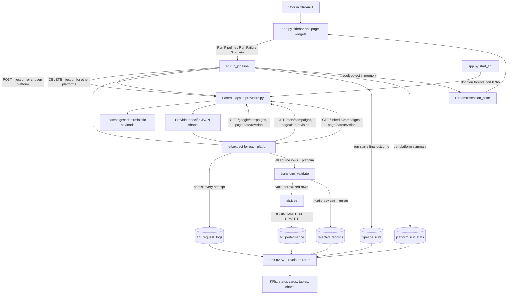
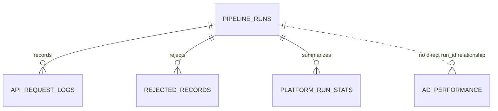

# AdPulse Complete Technical Guide

**Study guide for the implementation currently in this repository**  
Product: **AdPulse — Reliable data. Clear decisions.**  
Inspected: 2026-11-03

> This document describes the code that exists here. Google Ads, Meta Ads and LinkedIn Ads are local simulators. The application does not connect to real advertising accounts. Recommendations are marked as production improvements rather than existing features.

## Contents

1. Project overview and initial inspection
2. Architecture and data-flow diagram
3. Repository inventory
4. File-by-file and function-by-function walkthrough
5. Simulated API contracts
6. HTTP reliability and failure injection
7. ETL and validation
8. SQLite schema and SQL concepts
9. Idempotency, loading behavior, and limits
10. Dashboard and analytics
11. Exact execution flow
12. Tests and debugging commands
13. Production readiness and trade-offs
14. Technical interview preparation
15. Glossary

---

## 1. Project overview and initial inspection

### Problem being demonstrated

A marketing team needs a consistent daily view of campaign spend, impressions, clicks, and conversions from multiple ad platforms. Each provider can use a different response format, paginate its data, and fail temporarily. AdPulse demonstrates calling three local provider simulators, normalizing their responses, validating records, storing them in SQLite, and reporting the result.

### A. Project structure

```text
INFOTECH/
├── .gitignore
├── .streamlit/
│   └── config.toml
├── README.md
├── requirements.txt
├── app.py
├── adpulse/
│   ├── __init__.py
│   ├── db.py
│   ├── etl.py
│   └── providers.py
├── tests/
│   └── test_core.py
├── ADPULSE_COMPLETE_TECHNICAL_GUIDE.md  # this document
└── adpulse.sqlite3                      # generated at runtime; ignored by Git
```

There is no separate JavaScript frontend, SQL migration directory, scheduler module, Docker setup, or separate API-client package. The database file is created at runtime and is excluded by `.gitignore`.

### B. Technology stack detected

| Technology | Actual use |
|---|---|
| Python 3.12.6 in the inspected environment | Application language; requirement says Python 3.11+ |
| Streamlit | UI, sidebar navigation, widgets, metric cards, tables, charts, reruns |
| FastAPI | Local API simulator, route registration, query validation |
| Uvicorn | Starts the FastAPI app in a daemon thread inside Streamlit |
| Requests | HTTP calls from the ETL client to localhost |
| Pandas | Reads SQL query results and aggregates/display data |
| Plotly Express | Area, bar, and line charts |
| SQLite (`sqlite3`) | Persistent relational database and transactions |
| Pytest + FastAPI `TestClient` + HTTPX | Automated tests |
| Pydantic | Installed transitively/explicitly with FastAPI, but no custom Pydantic model is defined in this project |

`numpy` is listed in `requirements.txt` for the data stack but is not imported directly by AdPulse source files. `httpx` is present for the FastAPI test client. There is no APScheduler dependency and no scheduled job.

### C. Main application execution flow

1. `python -m streamlit run app.py` starts Streamlit and executes `app.py`.
2. `app.py` calls `start_api()`, which starts `adpulse.providers:app` under Uvicorn on `127.0.0.1:8765` in a daemon thread and polls `/health`.
3. `db.init_db()` creates the SQLite schema (and performs a small compatibility migration for `source_payload`).
4. The Streamlit script reads database tables into Pandas DataFrames.
5. The selected sidebar page is rendered.
6. A Run Pipeline button calls `run_pipeline(...)` synchronously in the Streamlit script.
7. For each platform, the orchestrator configures or clears failure injection, then calls `extract(...)` for all pages.
8. The ETL transforms and validates the extracted payloads, calls `db.load(...)` for valid rows, stores rejected rows, and finalizes the run.
9. `st.rerun()` restarts the Streamlit script; its database reads refresh the display.

### D. Important files to understand first

1. `app.py`: entry point, local API startup, six pages, UI-to-pipeline call.
2. `adpulse/providers.py`: generated campaign data, three response shapes, failure injection.
3. `adpulse/etl.py`: pagination, retry policy, response parsing, validation, orchestration.
4. `adpulse/db.py`: schema, logging persistence, UPSERT and inserted/updated counts.
5. `tests/test_core.py`: exactly which behaviors have automated coverage.
6. `requirements.txt`, `.streamlit/config.toml`, `README.md`, `.gitignore`: runtime/configuration context.

### E. Missing, incomplete, or potentially risky behavior

These points matter in an interview because they distinguish a demonstration from a production connector:

- There is no scheduler, background queue, or recurring job. Runs are started by a user in Streamlit.
- There is no OAuth, API key, authorization header, token refresh, or connection to an actual provider. The simulated endpoints need no credentials.
- The FastAPI app is started inside the Streamlit process on a fixed port. It is not an independently deployed service and can encounter a port conflict.
- `pipeline_watermarks` and `failed_records` do not exist. The actual rejection table is `rejected_records`; the app does not implement a watermark or incremental cursor.
- `ad_performance` has the composite unique key needed to avoid duplicate rows, but a same-data rerun still executes an UPDATE and changes `updated_at`. So row-count idempotency is demonstrated; “no database side effects on identical input” is not.
- The generated metric formulas depend on date and campaign position, not platform. The three providers have different names and IDs, but campaign-position metrics are numerically identical across providers for a given date/revision.
- No real currency conversion occurs. Generated spend is a numeric demo amount, and the UI formats it with `$`.
- Validation does not explicitly reject floating-point `NaN` or infinity, and the API data is well-formed by default. Rejected-record persistence is not exercised by the pipeline tests.
- A 429/503 `Retry-After` is used directly and is not capped by `max_delay`; the cap applies to generated exponential delays.
- `requests.Timeout` is retried, but other `requests.RequestException` cases are logged and returned as terminal failures.
- A failure while writing rejected rows occurs after `db.load` has committed. The outer error handler then finalizes the run as failed with zero insert/update counts even though valid rows may already have committed.
- SQL foreign keys point from child rows to `pipeline_runs`; there is no explicit index on log `run_id` columns. SQLite creates auto-indexes for primary keys and the `ad_performance` unique constraint.
- The UI imports DM Sans and Manrope from Google Fonts. Provider/API operation itself is local, but those remote fonts need network access to load.
- No SQL `DELETE`, explicit `ROLLBACK`, or `executemany` call exists in the application code. SQLite's connection context manager commits on success and rolls back if the block raises.
- The summary table in Streamlit's session state disappears after restarting the app; persistent run history remains in SQLite.

### F. Proposed teaching order

Follow the requested sequence: architecture → files/entry points → simulator → extraction → pagination → retries → transform/validation → schema/transactions → UPSERT/idempotency → watermarks (what is absent) → orchestration → monitoring → UI analytics → tests/production.

---

## 2. Architecture and data-flow diagram

AdPulse is a local, synchronous, single-user demonstration. The “client” and UI run in the Streamlit process; HTTP requests cross the loopback interface to the FastAPI app running on a daemon thread.



### Stages, purpose, and failure paths

| Stage | Actual implementation | Purpose | What follows / failure behavior |
|---|---|---|---|
| Manual trigger | `pipeline_controls()` in `app.py` | User chooses date/revision and starts work | Calls `run_pipeline`; exceptions are caught and shown in a Streamlit error box |
| Simulator start | `start_api()` in `app.py` | Make local routes available without a second terminal | Polls `/health`; it does not raise a clear startup error if all 30 checks fail |
| Injection config | `run_pipeline()` POSTs or DELETEs `/admin/injection` | Configure zero or more platforms to fail for a set number of actual requests | One config per selected platform is supported; other platforms have injection cleared. Requests have 2-second timeouts; a failure here reaches the outer pipeline exception handler |
| Extraction | `extract()` in `etl.py` | GET each page and persist attempts | Retryable statuses/timeouts retry; permanent statuses stop that provider; previous successful page data can still be retained |
| Pagination | `parse_response()` plus `while page` | Read each provider’s continuation field | A malformed/missing page structure may terminate early or raise; extraction retains source payload rows in memory |
| Transformation | `transform_validate()` | Map records to common fields/types | Each record becomes valid or rejected; malformed types are not converted to zero |
| Load | `db.load()` | Transactionally UPSERT valid data | `BEGIN IMMEDIATE`; connection context commits or rolls back the load transaction |
| Rejection persistence | `run_pipeline()` inserts into `rejected_records` | Keep malformed input and why it failed | This is a separate transaction after valid load, not atomic with it |
| Run finalization | `finish_run()` | Save status, totals, duration | An exception handler finalizes status as Failed then re-raises |
| Monitoring | logs/stats and UI SQL reads | Show historical outcomes | Streamlit `st.rerun()` refreshes DB-derived state after button action |

---

## 3. Repository inventory

### `app.py` — UI and application bootstrap

**Responsibility:** Streamlit entry point. Starts Uvicorn, initializes DB, reads persisted state, builds navigation, and calls the pipeline.

**Important functions:** `start_api`, `money`, `header`, `latest_status`, `kpis`, `pipeline_controls`.

**Inputs/outputs:** UI widgets provide reporting date, revision, and optional failure settings. `pipeline_controls` calls the ETL function and stores its returned dictionary in `st.session_state['last_result']`. Page renderers display DataFrames, metrics, statuses, and Plotly figures.

**Calls:** `db.init_db`, `db.connect`, `run_pipeline`, pandas/Plotly and Streamlit APIs. `start_api` runs FastAPI’s `app` in a thread.

### `adpulse/providers.py` — local simulated APIs

**Responsibility:** FastAPI object `app`, campaign name lists, in-memory `INJECTIONS`, deterministic data generation and JSON response variation.

**Important functions:** `health`, `configure_injection`, `clear_injection`, `campaigns`, `get_campaigns`.

**Inputs/outputs:** HTTP path/query values; outputs JSON with provider-specific keys. Failure controls return simulated error status codes or delay responses.

**Calls:** no database code; `get_campaigns` uses `asyncio.sleep` and returns generated records.

### `adpulse/etl.py` — extraction through orchestration

**Responsibility:** Requests local provider pages, retries safe GET requests, parses pagination, transforms/validates records, and coordinates persistence.

**Important functions:** `utcnow`, `retry_after`, `backoff`, `extract`, `parse_response`, `transform_validate`, `run_pipeline`.

**Inputs/outputs:** provider names, report date, run ID, retry configuration and injection settings. `run_pipeline` returns a summary dictionary containing overall status, counts, per-platform values, events, and run ID.

**Calls:** `requests`, provider admin endpoints, `db` persistence helpers.

### `adpulse/db.py` — SQLite storage

**Responsibility:** Resolve DB path, connect, initialize tables, persist run/request records, UPSERT normalized ad rows.

**Important functions:** `now`, `connect`, `init_db`, `insert_run`, `finish_run`, `log_request`, `load`.

**Inputs/outputs:** parameter values and normalized dictionaries. `load` returns `(inserted_count, updated_count)`.

### `tests/test_core.py` — unit/component tests

**Responsibility:** Verify provider schemas/pagination/determinism, revision behavior, some validation outcomes, Retry-After parsing, and UPSERT row-count/update behavior.

**Does not test:** full `run_pipeline` over real HTTP, retry exhaustion end-to-end, provider failure injection responses, SQL rollback, status/partial-failure behavior, or Streamlit UI rendering.

### Configuration and docs

- `requirements.txt`: package ranges.
- `.streamlit/config.toml`: light theme colors. CSS in `app.py` applies fonts and layout styling.
- `README.md`: setup/demo/architecture summary. Its standard `streamlit run app.py` assumes the `streamlit` executable maps to the same Python environment as `pip`; on the inspected computer, `python3 -m streamlit` worked while a separate `streamlit` executable resolved to a Python 3.13 installation missing `packaging`. Prefer module invocation in that mixed environment.
- `.gitignore`: ignores virtualenv, Python cache, pytest cache, and generated SQLite DB.
- `adpulse/__init__.py`: empty package marker.

---

## 4. File-by-file and function-by-function walkthrough

### 4.1 `app.py`

#### Bootstrap and `start_api()`

At module execution, imports happen first, then `st.set_page_config(...)`. `start_api()` checks a Streamlit session-state flag. If absent, it starts `uvicorn.run(api_app, host='127.0.0.1', port=8765, log_level='error')` in a daemon thread, sets the flag, then checks `/health` up to 30 times with a 0.2-second request timeout and 0.1-second sleep after errors.

The daemon-thread choice keeps the API server from blocking Streamlit’s main script. This is convenient for a local demo, but it couples service lifecycle and port allocation to the UI process. It is not a multi-process service manager. If the port is occupied, Uvicorn may fail in the background; the health loop currently does not explicitly report exhaustion.

After startup, `db.init_db()` runs. The script loads entire tables (`ad_performance`, `pipeline_runs`, `api_request_logs`, `rejected_records`, `platform_run_stats`) into Pandas DataFrames. This is simple for small demo volumes; full-table reads and in-memory aggregation do not scale to large histories.

#### `money(v)`

Returns a string formatted as dollars with commas and two decimal places, e.g. `money(9248.4) -> "$9,248.40"`. It does not convert currency; `$` is a presentation choice.

#### `header(title, sub)`

Renders a Streamlit title and an HTML subtitle. The subtitle string is inserted into HTML with `unsafe_allow_html=True`; values are internal literals today. If this ever accepted untrusted input, HTML escaping would be important.

#### `latest_status(platform)`

Filters `platform_run_stats` for one platform. If empty it returns `('Not Yet Synced', None)`. Otherwise it returns the first row, relying on the DataFrame having been loaded `ORDER BY id DESC`. This supplies current status, records, attempt counts, last HTTP status, duration, failures, and recoveries to overview cards.

#### `kpis()`

Calculates values from the dataframes loaded from SQLite:

- Spend: `perf.spend.sum()`.
- Clicks, conversions and impressions: sums across all stored performance rows.
- Records stored: `len(perf)`.
- Successful requests: count where `logs.event == 'success'`.
- Failed requests: count where event is anything other than `success` (therefore retry events count as failed attempts too).

The current code lays out three metrics in one row and four in the next. Empty performance data yields zero values.

#### `pipeline_controls(lab=False)`

This reusable UI function appears in Overview, Pipeline Operations, and Failure Injection Lab.

- Always collects a reporting date (default: local `date.today() - 1 day`) and source dataset (`Original dataset` or `Modified dataset · revision 1`).
- If `lab=True`, it shows platform, provider response scenario, failure count, max retries, base delay, and max delay widgets.
- It maps the displayed scenario label to a string code and builds an `inj` dictionary. Retry-After is fixed at 0.2 seconds in this UI; it is not user-configurable. Timeout simulation uses two seconds.
- A click creates a progress bar, runs `run_pipeline(...)` synchronously, displays a success summary, stores the result in session state, and calls `st.rerun()`.
- Errors are caught as broad `Exception` and shown in a Streamlit error widget.
- On later render, a nonempty session result is displayed as a summary and a per-platform table.

“Live progress” is stage-based: the callback advances through Google, Meta and LinkedIn. The UI does not stream each HTTP retry as it happens; it displays the persisted timeline after the pipeline completes.

#### Page renderers

The selected `page` value comes from the sidebar radio list:

1. **Overview**: KPIs, simulation label, three platform cards, pipeline controls and daily spend area chart.
2. **Pipeline Operations**: pipeline controls plus 15 most recent run rows.
3. **Failure Injection Lab**: scenario controls, latest run summary and request timeline/attempt metrics.
4. **Database Explorer**: filterable performance records and rejected records tabs. The raw `source_payload` is omitted from the performance table for readability.
5. **Execution History**: all run rows, then selected run’s request logs.
6. **Marketing Analytics**: filters by platform; total spend, aggregate CTR, aggregate CPA, platform spend chart, daily clicks/conversions chart, and grouped campaign table.

The sidebar radio is the page router; there is no separate router framework.

### 4.2 `adpulse/providers.py`

#### `app`

A `FastAPI` instance named “AdPulse Simulated Ad APIs”. It is the ASGI object Uvicorn starts. Routes are registered by decorators.

#### `PLATFORMS` and `NAMES`

`PLATFORMS` maps path slugs (`google`, `meta`, `linkedin`) to labels. `NAMES` contains seven deterministic campaign names for each slug.

#### `INJECTIONS`

A process-local dictionary. It is deliberately not stored in SQLite. Each platform can hold an injection configuration with a `remaining` failure counter and request `calls` count. Restarting the process clears these controls.

#### `health()`

`GET /health` returns a tiny JSON health check with `status: ok` and `data_label: Simulated Demonstration Data`. It verifies process responsiveness, not real advertising connectivity.

#### `configure_injection(config)`

`POST /admin/injection` receives a JSON dictionary, checks that `platform` is a known slug, then stores a copy with `remaining` initialized from `failures_before_recovery` and `calls=0`. Unknown platform is HTTP 400. It does not use a custom Pydantic model; `config` is a plain dictionary.

#### `clear_injection(platform)`

`DELETE /admin/injection/{platform}` removes that entry if present and returns `{"cleared": true}`. This is an admin simulator endpoint, not a SQL deletion.

#### `campaigns(platform, report_date, revision=0)`

Creates seven records in memory on each call. It computes a date-derived `seed = sum(report_date.isoformat().encode()) % 97`. Campaign index affects spend/impressions/clicks/conversions. Revision 1 changes the first campaign’s metrics only. The IDs are generated from the first two characters of the slug, e.g. `GO-001`, `ME-001`, `LI-001`.

This function ensures the same date/revision returns repeatable values. There is no persistent source catalog and no random metric generation. For a given date/revision, all three platforms use the same metric arithmetic by campaign index; only IDs/names differ.

#### `get_campaigns(...)`

Route: `GET /{platform}/campaigns`; paths used are `/google/campaigns`, `/meta/campaigns`, `/linkedin/campaigns`.

Query parameters:

- `report_date`: required ISO date, parsed as Python `date` by FastAPI.
- `page`: integer >= 1, default 1.
- `page_size`: integer 1–50, default 4.
- `revision`: integer >= 0, default 0.

It validates the slug, consumes any configured injection, applies a short async delay, slices the generated rows, and emits different JSON keys. For network-timeout injection it awaits a longer response delay; the ETL’s shorter client timeout expires while the coroutine keeps the server able to process the retry.

### 4.3 `adpulse/etl.py`

#### Constants and `utcnow()`

- `BASE_URL` is fixed at `http://127.0.0.1:8765`.
- `SLUGS` maps display names to route slugs.
- `RETRYABLE = {429, 500, 502, 503, 504}`.
- `utcnow()` returns a UTC ISO timestamp rounded to seconds.

There are no configurable API credentials, base URL environment variable, shared requests session, or common headers.

#### `retry_after(value)`

Returns `None` when the header is absent or invalid. Otherwise it tries a floating-point number of seconds and clamps negative delays to zero. If numeric parsing fails, it parses an HTTP-date and returns the nonnegative number of seconds until that timestamp. It does not cap server-supplied Retry-After at `max_delay`.

#### `backoff(attempt, base, maximum)`

Computes `min(base * 2**max(0, attempt-1), maximum)` then multiplies by random jitter between 0.75 and 1.25. Attempts start at 1, so attempt 1 uses approximately the base delay. The resulting jittered delay can exceed `maximum` by up to 25%, because the maximum is applied before jitter.

#### `extract(...)`

Parameters: display platform name, report date, run ID, optional injection config, source revision, maximum retries, base/max delays, request timeout and page size.

Execution:

1. Map platform label to URL slug, initialize page 1 and event/data lists.
2. Build query parameters for the selected page/date/size/revision.
3. Start attempt counter at zero for each page; increment before each HTTP call.
4. Call `requests.get(endpoint, params=params, timeout=timeout)`.
5. On a response for which Requests says `response.ok` (status below 400; redirects are followed by default), decode JSON, call `parse_response`, append payload rows with a `source_platform`, log success, and move to the next page. The simulator normally returns HTTP 200.
6. On non-2xx, build an error message. Retry only if status is in `RETRYABLE` and `attempt <= max_retries`. For 429/503, try `Retry-After`; otherwise use exponential backoff+jitter. Log every response as `retry` or `failed`.
7. On `requests.Timeout`, log no HTTP status and retry with backoff while retry allowance remains.
8. Other `requests.RequestException` exceptions are logged once as terminal failure.
9. Return `(data, all_events, success, last_status)`.

With `max_retries=3`, the first attempt plus up to three retries are permitted: four tries total for one page. Attempts restart for each page. A successful first page followed by a failed second page returns data from page one but `success=False`.

The `config` parameter is accepted but not used inside `extract`; the orchestrator configures the provider before calling it.

#### `parse_response(slug, payload)`

- Google: rows from `results`, next page from `next_page`.
- Meta: rows from `data`, next page from `paging.next_page`.
- LinkedIn: rows from `elements`; next page is current page + 1 while current is below `total_pages`.

A present-but-malformed provider shape can return empty rows or raise an exception. JSON decode/schema exceptions are not retried as HTTP statuses.

#### `transform_validate(items, run_id)`

For each item, it takes `item['payload']` as the original provider dictionary and `item['source_platform']` as the trusted display platform. It constructs a common record with `campaign_id`, `campaign_name`, `report_date`, `spend`, `impressions`, `clicks`, `conversions`, and serialized `source_payload`.

Validation:

- `campaign_id` and `campaign_name` must become nonempty strings.
- Date must parse with `date.fromisoformat`.
- Spend must convert to float and must not be less than zero.
- Impressions, clicks and conversions must be Python integers, not bools, and >= 0.

Records with any errors are returned in a rejected list with run ID, platform, raw date, original payload, joined error string and UTC timestamp. It does not silently replace malformed metrics with zero. It also does not validate platform against an allow-list here, and it does not explicitly reject `NaN`/infinite spend.

Returns `(valid_records, rejected_records)`.

#### `run_pipeline(...)`

This is the orchestrator called by Streamlit.

1. Generates UUID run ID, start time and monotonic clock; persists a `Running` row.
2. Loops through platform display names in insertion order: Google, Meta, LinkedIn.
3. Calls progress callback when provided.
4. Normalizes a single config or list of configs by provider; posts each configured injection and deletes injection for other platforms.
5. Calls `extract`, collects raw items/events, builds per-platform outcome and persists a `platform_run_stats` row.
6. Calls `transform_validate` for all collected items.
7. Calls `db.load(valid)` once for all valid records.
8. Inserts rejected records in a separate connection transaction.
9. Overall status is `Failed` if all three provider extractions failed; `Partial Success` if some failed; otherwise `Successful`.
10. Persists final totals/status/duration via `finish_run` and returns a result dictionary.
11. On an exception, finalizes a failed run and re-raises.

Important distinction: a provider failure does not necessarily prevent its earlier pages’ data from being loaded. A failed provider with no rows is counted as failed; a later overall status can still be partial if other providers succeeded.

### 4.4 `adpulse/db.py`

#### `DB_PATH`

Uses `ADPULSE_DB` if set; otherwise path is repository-root `adpulse.sqlite3`.

#### `now()`

Returns a UTC ISO timestamp to second precision.

#### `connect()`

Opens SQLite with 20-second busy timeout, sets `sqlite3.Row` row access, and runs `PRAGMA foreign_keys=ON`. It returns a connection. `with connect() as c:` manages commit/rollback but Python’s connection context manager is not itself a guaranteed close operation; short-lived local references are released by CPython, but a dedicated context helper could make closure explicit.

#### `init_db()`

Creates five tables with `CREATE TABLE IF NOT EXISTS`. It checks `PRAGMA table_info(ad_performance)` and adds nullable `source_payload` for older database files if absent. This is a small hand-written migration, not a general migration framework.

#### `insert_run(run_id, started)`

Parameterized `INSERT` into `pipeline_runs` with status `Running`.

#### `finish_run(run_id, **v)`

Parameterized `UPDATE` of completed time, status, counts, request totals, duration, summary. It updates one row selected by primary key.

#### `log_request(...)`

Parameterized `INSERT` into `api_request_logs` for each attempt/response, including endpoint/page/status/event/delay/start/duration/error.

#### `load(records)`

1. Opens a connection and starts `BEGIN IMMEDIATE`, acquiring SQLite’s write reservation before checking rows.
2. For every record, selects existing `id` by `(platform, campaign_id, report_date)`.
3. Runs parameterized `INSERT ... ON CONFLICT ... DO UPDATE`.
4. Counts as inserted if the prior SELECT had no row; otherwise counts as updated.
5. Returns `(inserted, updated)`.

If the block raises, SQLite’s connection context rolls back this loading transaction. There is no handwritten `ROLLBACK` statement. The API/run log operations before this are separate transactions, so they do not roll back with the ad load.

---

## 5. Simulated API contracts

### Common behavior

All routes are local HTTP GETs, generated by `extract()`. Each accepts the reporting date, page, page size and revision. No authorization headers, API keys, cookies, OAuth scopes or real provider SDKs are used. `requests` adds its normal HTTP defaults; AdPulse does not set custom request headers.

The data label is included in responses as `Simulated Demonstration Data`.

### Google Ads simulator

- Endpoint: `GET http://127.0.0.1:8765/google/campaigns`
- Example request: `GET /google/campaigns?report_date=2026-11-01&page=1&page_size=4&revision=0`
- Response shape:

```json
{
  "results": [
    {
      "campaign_id": "GO-001",
      "campaign_name": "Search - Brand",
      "report_date": "2026-11-01",
      "spend": 244.4,
      "impressions": 17238,
      "clicks": 230,
      "conversions": 15
    }
  ],
  "next_page": 2,
  "data_label": "Simulated Demonstration Data"
}
```

Seven generated rows, page size four means page 1 has four and page 2 has three.

### Meta Ads simulator

- Endpoint: `GET http://127.0.0.1:8765/meta/campaigns`
- Response row list is under `data` and continuation is `paging.next_page`:

```json
{
  "data": [{"campaign_id":"ME-001","campaign_name":"Prospecting - Broad","report_date":"2026-11-01","spend":244.4,"impressions":17238,"clicks":230,"conversions":15}],
  "paging": {"next_page": 2},
  "data_label": "Simulated Demonstration Data"
}
```

### LinkedIn Ads simulator

- Endpoint: `GET http://127.0.0.1:8765/linkedin/campaigns`
- Response row list is under `elements`; page count is under `pagination`:

```json
{
  "elements": [{"campaign_id":"LI-001","campaign_name":"Enterprise Demand Gen","report_date":"2026-11-01","spend":244.4,"impressions":17238,"clicks":230,"conversions":15}],
  "pagination": {"page": 1, "total_pages": 2},
  "data_label": "Simulated Demonstration Data"
}
```

### Why formats differ

Real providers often evolve APIs independently, so pagination and naming conventions differ. AdPulse uses these differences to demonstrate adapter/parsing logic. The provider response parser maps all of them to a list of source payload dictionaries plus a next-page value. It is an architecture demonstration only; schemas are illustrative, not official production API payloads.

### Simulated statuses

The injection route can emit 429, 500, 503, 400 and 403. The timeout setting holds the async route response beyond the client timeout. Selecting HTTP 200 does not inject an error. The simulator does not expose UI choices for 401, 502, or 504, though the client classifies 502/504 as retryable and a 401 response would be terminal.

---

## 6. HTTP reliability and failure injection

### HTTP basics in this project

- **GET** asks the simulator for data. It is safe to repeat because it does not change campaign records.
- Query parameters (`params={...}`) encode report date, page, page size, revision; Requests URL-encodes them.
- JSON response bodies are decoded with `response.json()`.
- HTTP status is read from `response.status_code`; Requests' `response.ok` is true for status codes below 400. Redirects are followed by default; the simulator normally returns HTTP 200.
- `timeout` bounds how long the client waits for the response. A timeout does not prove the server never completed work; for this GET demo, retry is safe.
- Requests exceptions are Python exceptions; `requests.Timeout` is caught before the broader `requests.RequestException`.

### Retry code excerpt

The central logic is in `adpulse/etl.py`:

```python
can_retry = response.status_code in RETRYABLE and attempt <= max_retries
delay = retry_after(response.headers.get("Retry-After")) \
    if response.status_code in (429, 503) else None
if can_retry:
    delay = delay if delay is not None else backoff(attempt, base_delay, max_delay)
    event["delay"] = delay
    event["event"] = "retry"
else:
    event["event"] = "failed"
...
if can_retry:
    time.sleep(delay)
    continue
```

Status classification:

| Response/error | Actual behavior |
|---|---|
| 200 | Parse JSON and process page |
| 400 | Terminal; no automatic retry |
| 401 | Not in `RETRYABLE`, so terminal. No token-refresh flow exists |
| 403 | Terminal |
| 429 | Retry while within limit; use `Retry-After` if valid |
| 500 | Retry with exponential delay + jitter |
| 502 | Retry with exponential delay + jitter if encountered |
| 503 | Retry while within limit; use `Retry-After` if valid |
| 504 | Retry with exponential delay + jitter if encountered |
| `requests.Timeout` | Retry with exponential delay + jitter |
| Other `RequestException` | Log once and return failure |

With `max_retries=N`, condition `attempt <= N` allows N retries after the initial attempt. Example: `max_retries=3` means up to four requests to the same page.

### Backoff and jitter

Base formula implemented before jitter:

`min(base_delay * 2 ** (attempt - 1), max_delay)`

Then random multiplier: `uniform(0.75, 1.25)`. Jitter spreads retrying clients in time, reducing synchronized “thundering herd” retries. Note the implementation applies the random multiplier after the max cap, so final delay can reach 1.25 × max delay.

`Retry-After` supports seconds and HTTP-date syntax. For 429/503, valid `Retry-After` overrides the backoff/jitter delay. It is clamped to >= 0 but is not bounded by the configured maximum delay.

### Timeline and persisted events

Each actual HTTP response/timeout calls `db.log_request`. Event values include `success`, `retry`, and `failed`; fields include `status_code`, attempt, page, delay, duration, endpoint, and error. The Failure Injection Lab reads these rows for its timeline. For a timeout, status code is NULL and error text says `Network timeout after ...s`.

### Failure injection sequence: example 429

Suppose the UI targets Google, chooses HTTP 429, sets two failures before recovery, max retries three:

1. Streamlit creates an injection dictionary and calls `run_pipeline`.
2. Orchestrator POSTs configuration to `/admin/injection` for Google; it clears injection for Meta and LinkedIn.
3. `extract` sends GET page 1.
4. Provider decrements `remaining` and returns HTTP 429 with `Retry-After: 0.2`.
5. Client logs `retry`, sleeps 0.2s, sends GET again.
6. Provider returns a second HTTP 429; client logs and retries again.
7. Provider now returns HTTP 200 because the two injected failures were consumed.
8. Client parses page 1, logs success, and fetches page 2 (200).
9. Pipeline loads all valid rows and finalizes status Successful; platform stats show two failed attempts and one recovery.

For permanent 403, the first 403 is logged as `failed` and no automatic retry occurs. Other providers continue, so overall outcome is normally Partial Success. For timeout injection, provider awaits longer than the client timeout once, then the following GET may succeed.

---

## 7. ETL: extraction, transformation, validation, loading

### Extraction

`run_pipeline` calls `extract` once for each platform. Each `extract` call loops page-by-page. Data kept in memory is a list like:

```python
{"source_platform": "Google Ads", "payload": {
    "campaign_id": "GO-001", "campaign_name": "Search - Brand",
    "report_date": "2026-11-01", "spend": 244.4,
    "impressions": 17238, "clicks": 230, "conversions": 15
}}
```

The `source_platform` comes from the orchestrator’s mapping, not from an untrusted API-supplied platform field.

### Transformation

The current implementation maps provider payload keys directly to one common schema. It stringifies campaign ID/name/date; parses and normalizes date using `date.fromisoformat`; converts spend to float; leaves metrics as ints after validation. It serializes the raw payload to JSON for storage.

There is **no** currency exchange, timezone conversion, currency-code field, name cleanup beyond string trim, or source-specific field translation (the simulators already use near-identical metric keys).

### Validation

The implemented checks are required campaign ID/name, ISO date, numeric/nonnegative spend, and nonnegative integer impressions/clicks/conversions. A Python bool is rejected as a metric even though bool is a subclass of int.

For rejected records, `rejected_records` stores run ID, platform, source reporting date, JSON source payload, joined validation errors and rejection timestamp. The source reporting date is stored as received, even when invalid.

### Loading

Valid rows are loaded with parameterized SQL. The ad data load uses a single explicit `BEGIN IMMEDIATE` transaction. A successful connection context commits. An exception during `db.load` rolls that transaction back. Rejected rows are written afterward in a different transaction.

### Example end-to-end record

Input response row:

```json
{"campaign_id":"GO-001","campaign_name":"Search - Brand","report_date":"2026-11-01","spend":244.4,"impressions":17238,"clicks":230,"conversions":15}
```

After transform/validation:

```python
{
  "platform": "Google Ads",
  "campaign_id": "GO-001",
  "campaign_name": "Search - Brand",
  "report_date": "2026-11-01",
  "spend": 244.4,
  "impressions": 17238,
  "clicks": 230,
  "conversions": 15,
  "source_payload": "{...original JSON...}"
}
```

After load, its uniqueness key is `("Google Ads", "GO-001", "2026-11-01")`.

---

## 8. Database schema and SQL concepts

The live inspected DB contained 21 ad rows, 6 pipeline runs, 40 API request logs, 18 platform-run rows, and 0 rejected records. These are local simulated demo data, not live ad metrics.

### Actual tables

#### `ad_performance`

| Column | SQLite type | Meaning |
|---|---|---|
| `id` | INTEGER PRIMARY KEY | Row identity |
| `platform` | TEXT NOT NULL | Display platform name |
| `campaign_id` | TEXT NOT NULL | Provider campaign ID |
| `campaign_name` | TEXT NOT NULL | Campaign label |
| `report_date` | TEXT NOT NULL | ISO reporting date |
| `spend` | REAL NOT NULL | Numeric demo spend |
| `impressions` | INTEGER NOT NULL | Impression count |
| `clicks` | INTEGER NOT NULL | Click count |
| `conversions` | INTEGER NOT NULL | Conversion count |
| `source_payload` | TEXT | JSON of original row |
| `created_at` | TEXT NOT NULL | UTC ISO creation timestamp |
| `updated_at` | TEXT NOT NULL | UTC ISO last load timestamp |
| Unique constraint | `(platform, campaign_id, report_date)` | One row for a platform campaign and reporting date |

The unique constraint creates a SQLite autoindex. There is no explicit secondary index.

#### `pipeline_runs`

`run_id TEXT PRIMARY KEY`, `started_at TEXT NOT NULL`, `completed_at TEXT`, `status TEXT NOT NULL`, `records_fetched`, `records_inserted`, `records_updated`, `records_rejected`, `successful_requests`, `failed_requests`, `duration_seconds`, `summary`.

One row is created as Running and updated at completion. It stores aggregate run-level counts; provider-specific counts live in `platform_run_stats`.

#### `api_request_logs`

`id INTEGER PRIMARY KEY`, `run_id`, `platform`, `endpoint`, `page`, `attempt`, `status_code`, `event`, `delay_seconds`, `started_at`, `duration_seconds`, `error`.

Foreign key: `run_id -> pipeline_runs.run_id`. Each response/timeout attempt is one row. No explicit index on `run_id` is declared.

#### `rejected_records`

`id INTEGER PRIMARY KEY`, `run_id`, `platform`, `report_date`, `source_payload`, `validation_error`, `rejected_at`.

Foreign key: `run_id -> pipeline_runs.run_id`. This is the actual name; there is no `failed_records` table.

#### `platform_run_stats`

`id INTEGER PRIMARY KEY`, `run_id`, `platform`, `status`, `records_fetched`, `attempts`, `failed_attempts`, `recoveries`, `last_http_status`, `duration_seconds`.

Foreign key: `run_id -> pipeline_runs.run_id`. It stores one per-provider summary per pipeline run.

### Relationships



`ad_performance` does not store `run_id`, so the current row cannot be traced directly to the run that last updated it. `source_payload` offers provenance of the source row but not load-run identity.

### Important actual SQL

#### Schema creation

```sql
CREATE TABLE IF NOT EXISTS ad_performance (
  id INTEGER PRIMARY KEY,
  platform TEXT NOT NULL,
  campaign_id TEXT NOT NULL,
  campaign_name TEXT NOT NULL,
  report_date TEXT NOT NULL,
  spend REAL NOT NULL,
  impressions INTEGER NOT NULL,
  clicks INTEGER NOT NULL,
  conversions INTEGER NOT NULL,
  source_payload TEXT,
  created_at TEXT NOT NULL,
  updated_at TEXT NOT NULL,
  UNIQUE(platform, campaign_id, report_date)
);
```

- `CREATE TABLE IF NOT EXISTS` allows startup to run repeatedly without recreating an existing table.
- `NOT NULL` prevents mandatory fields from being NULL at the DB layer.
- `INTEGER PRIMARY KEY` is SQLite’s row identity.
- `UNIQUE(...)` enforces the composite natural key.

#### Duplicate lookup

```sql
SELECT id FROM ad_performance
WHERE platform=? AND campaign_id=? AND report_date=?
```

The three `?` placeholders are bound values. For Google/GO-001/2026-11-01 it checks whether that logical record exists before counting the write as insert/update.

#### UPSERT

```sql
INSERT INTO ad_performance (...)
VALUES (?, ?, ?, ?, ?, ?, ?, ?, ?, ?, ?)
ON CONFLICT(platform,campaign_id,report_date) DO UPDATE SET
  campaign_name=excluded.campaign_name,
  spend=excluded.spend,
  impressions=excluded.impressions,
  clicks=excluded.clicks,
  conversions=excluded.conversions,
  source_payload=excluded.source_payload,
  updated_at=excluded.updated_at
```

- `INSERT` attempts to create the row.
- `ON CONFLICT` names the unique key that can conflict.
- `DO UPDATE` applies incoming values to the existing row.
- `excluded.column` means the value that the attempted insert would have supplied.
- `created_at` is not changed on conflict; `updated_at` is.

#### Dashboard query reads

Examples of exact reads in `app.py`:

```sql
SELECT * FROM ad_performance
SELECT * FROM pipeline_runs ORDER BY started_at DESC
SELECT * FROM api_request_logs ORDER BY id DESC
SELECT * FROM rejected_records ORDER BY id DESC
SELECT * FROM platform_run_stats ORDER BY id DESC
```

Pandas executes these statements and the UI aggregates the result in Python. There is not a database `GROUP BY` analytics query in the dashboard code.

#### Run insert/update

```sql
INSERT INTO pipeline_runs(run_id,started_at,status)
VALUES(?,?,'Running')
```

Then `finish_run` uses a parameterized `UPDATE pipeline_runs SET ... WHERE run_id=?` to save totals and final status.

#### API log insert

`log_request` uses `INSERT INTO api_request_logs(...) VALUES(?,?,?,?,?,?,?,?,?,?,?)` with all values passed separately from SQL text.

### SQL concepts and actual/inapplicable statements

- **SELECT/WHERE**: query records or lookup a unique key.
- **ORDER BY**: newest runs/log rows are read first by descending timestamp/ID.
- **SUM/COUNT/GROUP BY**: dashboard currently uses Pandas to sum/count. The equivalent SQL could be:

  ```sql
  SELECT platform, SUM(spend), SUM(clicks), COUNT(*)
  FROM ad_performance GROUP BY platform;
  ```

  This is an explanatory query, not a query presently executed by AdPulse.
- **INSERT**: creates a run, request log, rejected row, or ad record.
- **UPDATE**: finalizes a run; UPSERT’s conflict branch updates existing performance.
- **DELETE**: no SQL DELETE is implemented. The HTTP DELETE endpoint clears in-memory failure injection, not database rows.
- **Transactions**: `db.load` explicitly starts `BEGIN IMMEDIATE`; SQLite’s Python connection context commits on success/rolls back on exception.
- **COMMIT/ROLLBACK**: no literal SQL `COMMIT` or `ROLLBACK` statements appear. Those effects are supplied by the connection context manager.
- **Parameterized SQL**: values are bound as `?`; this avoids string-concatenating data into SQL and reduces injection risk.
- **`executemany`**: not used. Loading loops one record at a time with `execute`.
- **Indexes**: primary-key/unique constraints have SQLite-generated indexes; there are no explicitly declared `CREATE INDEX` statements.

### SQLite vs PostgreSQL

SQLite is easy to run locally: one file, no server setup, and adequate for a single-user deterministic demonstration. `BEGIN IMMEDIATE` and a 20-second busy timeout serialize writers, but SQLite is not the intended high-concurrency, multi-instance production database. PostgreSQL would add a database service, connection management/pooling, explicit migrations, stronger multi-writer concurrency, operational backups/monitoring, and potentially different SQL/UPSERT and timestamp types. The application code would need a database abstraction or SQL adaptation; replacing only the file path is not enough.

---

## 9. Idempotency and repeated runs

**Idempotency** means repeating an operation should not create duplicate logical records. AdPulse’s database uniqueness key is `(platform, campaign_id, report_date)`.

### What happens in common cases

- **First run for a date:** each of seven campaigns × three platforms is new; expected 21 inserts.
- **Same date and same dataset again:** still 21 logical rows. The pre-check sees them, UPSERT updates each, returned counts are `(0, 21)`.
- **Changed source revision:** campaign 1’s metrics change for each platform, while the other six rows are reloaded. `db.load` counts all 21 matched rows as updated; it does not compare value differences first.
- **New reporting date:** the date is part of the unique key, so the same campaign creates a new row for the new date.
- **Overlapping pages:** duplicate campaign/date rows cannot create a second row. The second occurrence becomes an UPSERT update. There is no explicit in-memory deduplication.
- **Load exception:** the `db.load` transaction rolls back all ad rows in that load call. Earlier run/request/per-platform log transactions are already committed and remain.
- **Two concurrent loads:** `BEGIN IMMEDIATE` serializes SQLite writers; the unique constraint remains the final duplicate guard. A writer may wait up to the SQLite timeout. There is no explicit application-level run lock.

### Important nuance

A repeated identical input is row-count-idempotent but not a no-op: every existing row is updated, and `updated_at` advances. This is an honest interview point. A stronger “only update when values differ” implementation would add a `WHERE` condition to the conflict update or compare old/new values before writing; that is not present.

### Incremental extraction and watermarks

There is no watermark table, last-success cursor, lookback window, or automatic date range. The user selects one reporting date and the pipeline requests that date from all providers. Calling it “incremental loading” would be inaccurate; this is user-selected date-slice loading with UPSERT semantics.

A production watermark might store provider, last successful report date/page/token, and updated time. A lookback window is useful for late-arriving or corrected conversions. A robust watermark should advance only after all required provider records for the chosen interval commit successfully. Neither behavior exists here.

### How to demonstrate

1. Open Overview or Pipeline Operations.
2. Choose a report date and Original dataset; run once.
3. Expected run summary: fetched 21; inserted 21; updated 0.
4. Run same date/source again: fetched 21; inserted 0; updated 21.
5. Choose Modified dataset: first campaign’s metrics change; matched rows still count as updated.
6. Database Explorer or CLI can verify one row for a composite key.

CLI check:

```bash
sqlite3 adpulse.sqlite3 "SELECT platform, campaign_id, report_date, COUNT(*) AS n FROM ad_performance GROUP BY platform, campaign_id, report_date HAVING n > 1;"
```

No rows should be returned.

---

## 10. Dashboard pages and analytics

All major KPI and table values come from database reads at the top of the Streamlit script, except the most recent execution summary, which is also held in Streamlit session state. No static KPI constants are used.

### Product Walkthrough

`adpulse/tour.py` renders the first-visit welcome screen and four feature demos: daily API collection, API reliability, database storage, and duplicate prevention. It also supports one complete walkthrough. Each demo is step-driven with Previous, Next, Pause/Continue, Replay, and Exit controls. Pipeline actions make actual requests to the local simulator and persist their normal run/request/data records. The scheduler step states that scheduling is disabled and presents 02:00 IST only as a proposed schedule. Provider field mapping reflects the actual `spend` field; no `cost_micros` conversion is claimed. The malformed validation example is labeled and is not persisted. The transaction rollback proof uses a temporary SQLite file.

### Overview

- KPI cards from `perf` and `logs` DataFrames.
- Platform status cards from latest `platform_run_stats` plus `api_request_logs` and `ad_performance`.
- Latest reporting date is the maximum stored per platform.
- Freshness is `latest report date >= date.today() - ADPULSE_FRESHNESS_DAYS`; default 3. It uses process-local date and is not tied to the selected run’s chosen date.
- Run Pipeline calls `pipeline_controls()`.
- Spend area chart groups `perf` by `report_date` and sums spend.

### Pipeline Operations

Calls the same no-injection pipeline control and displays up to 15 newest `pipeline_runs` rows. No scheduler controls exist.

### Failure Injection Lab

Calls `pipeline_controls(lab=True)`, which actually POSTs configuration and runs GET requests. It then displays persisted request rows for the latest session run (or latest DB run after a fresh session) and calculates total attempts, failed attempts (every event other than success), success attempts, and a final status. The detailed status code/duration/delay values are DB-derived.

### Database Explorer

Performance tab filters by platform and date range, then displays performance rows (except raw JSON payload). Rejected tab shows `rejected_records`. The UI does not offer edit/delete/reset operations.

### Execution History

Displays all `pipeline_runs`; selected run ID filters `api_request_logs`. There is no pagination; large history will be loaded/rendered in full.

### Marketing Analytics

The code computes:

- **Spend:** sum of spend for selected platforms.
- **CTR:** `sum(clicks) / sum(impressions) * 100`; denominator guarded for zero.
- **CPA:** `sum(spend) / sum(conversions)`; denominator guarded for zero.
- **Campaign CTR:** grouped clicks / grouped impressions × 100.
- **Campaign CPA:** grouped spend / grouped conversions; zero conversions are replaced by `pd.NA`.
- Daily chart: grouped spend/clicks/conversions, showing clicks and conversions as lines.

There is no separate conversion-rate KPI, API success-rate percentage, or conversion attribution model.

---

## 11. Exact end-to-end Run Pipeline flow

1. User selects a report date and original/modified source data in `pipeline_controls`.
2. User clicks **Run Pipeline**.
3. Streamlit enters the button block and creates progress/status widgets.
4. The `progress(name)` callback is passed into `run_pipeline`.
5. `run_pipeline` creates UUID, UTC start time and monotonic timer, then `db.insert_run` persists Running.
6. For Google, Meta, LinkedIn in sequence, callback reports stage progress.
7. For selected failure platform, it POSTs injection config; other platforms have injection cleared by HTTP DELETE.
8. `extract` requests page 1 via GET, with `report_date`, `page`, `page_size=4`, `revision` query parameters and timeout.
9. Provider consumes failure config, generates deterministic data and returns provider-specific JSON/status.
10. `extract` logs each response. Retryable statuses/timeouts sleep and retry; successful (`response.ok`) payloads are parsed and pagination continues.
11. Platform fetch result is added to in-memory list; `platform_run_stats` is inserted.
12. `transform_validate` normalizes all collected rows and splits valid/rejected.
13. `db.load(valid)` begins an immediate transaction, looks up keys, UPSERTs records, and commits when its context exits cleanly.
14. Rejected rows are separately inserted into `rejected_records`.
15. `finish_run` writes final status, counts, duration, successful/failed request counts and failure summary.
16. Result dictionary returns to Streamlit; it is stored in session state and success message shown.
17. `st.rerun()` re-executes `app.py`; DB DataFrames are refreshed and page renders new metrics/history.

```mermaid
sequenceDiagram
    actor User
    participant UI as Streamlit app.py
    participant ETL as run_pipeline / extract
    participant API as FastAPI providers.py
    participant DB as SQLite db.py

    User->>UI: Click Run Pipeline + choose date
    UI->>ETL: run_pipeline(date, revision, config)
    ETL->>DB: insert_run(Running)
    loop Google, Meta, LinkedIn
        ETL->>API: POST injection or DELETE injection
        loop Each page and retry
            ETL->>API: GET /{provider}/campaigns?date&page&size&revision
            API-->>ETL: 200 JSON, retryable status, or delayed response
            ETL->>DB: log_request(attempt/status/delay)
        end
        ETL->>DB: insert platform_run_stats
    end
    ETL->>ETL: transform_validate(raw items)
    ETL->>DB: BEGIN IMMEDIATE + UPSERT valid rows
    ETL->>DB: INSERT rejected_records
    ETL->>DB: UPDATE pipeline_runs(final status/counts)
    ETL-->>UI: result dictionary
    UI->>UI: store in session state; st.rerun()
    UI->>DB: SELECT performance/runs/logs/rejections/stats
    DB-->>UI: DataFrames
    UI-->>User: KPIs, statuses, timeline, charts
```

---

## 12. Tests and debugging

### What each test verifies

`python3 -m pytest -q` runs the suite.

1. `test_provider_pagination_and_determinism` is parametrized over three slugs, producing three test cases. It calls FastAPI using TestClient, checks repeated identical response equality, page row count 4, simulation label, and parser continuation page 2. It does not call the Requests-based extractor or test page 2 via the HTTP endpoint.
2. `test_source_revision_changes_metrics_only_when_selected` calls `campaigns` directly; verifies same revision deterministic and revision changes campaign 1 metrics only.
3. `test_validation_preserves_rejected_payload` calls `transform_validate` with one valid and one invalid record; checks campaign ID, numeric spend, negative impressions errors and raw payload retention. It does not write the rejected row into SQLite.
4. `test_retry_after_seconds_and_http_date` checks numeric header, parsed HTTP-date result, invalid date fallback. It does not test actual sleeping or provider headers.
5. `test_upsert_is_idempotent_and_updates` uses a temp DB; verifies first insert count `(1,0)`, second and modified writes `(0,1)`, and final table has one row with updated spend.

There are 7 cases total because the provider test creates three parametrized cases and there are four other test functions.

### Verified commands

From the repository root:

```bash
python3 -m venv .venv
source .venv/bin/activate
python3 -m pip install -r requirements.txt
python3 -m streamlit run app.py
```

The Streamlit process starts the API simulator automatically. Use the module form to ensure Streamlit uses the active Python interpreter.

To run only the simulator independently for API inspection (do not start a second copy while Streamlit’s auto-started server is active):

```bash
python3 -m uvicorn adpulse.providers:app --host 127.0.0.1 --port 8765
```

Check health or a page with curl:

```bash
curl 'http://127.0.0.1:8765/health'
curl 'http://127.0.0.1:8765/google/campaigns?report_date=2026-11-01&page=1&page_size=4&revision=0'
curl 'http://127.0.0.1:8765/meta/campaigns?report_date=2026-11-01&page=2&page_size=4&revision=0'
curl 'http://127.0.0.1:8765/linkedin/campaigns?report_date=2026-11-01&page=1&page_size=4&revision=0'
```

Test and compile:

```bash
python3 -m pytest -q
python3 -m compileall -q app.py adpulse tests
```

Inspect SQLite:

```bash
sqlite3 adpulse.sqlite3 '.tables'
sqlite3 adpulse.sqlite3 'PRAGMA table_info(ad_performance);'
sqlite3 adpulse.sqlite3 'SELECT platform,campaign_id,campaign_name,report_date,spend,impressions,clicks,conversions FROM ad_performance ORDER BY platform,campaign_id LIMIT 10;'
sqlite3 adpulse.sqlite3 'SELECT run_id,status,records_fetched,records_inserted,records_updated,records_rejected,successful_requests,failed_requests FROM pipeline_runs ORDER BY started_at DESC LIMIT 10;'
sqlite3 adpulse.sqlite3 'SELECT platform,status_code,event,attempt,delay_seconds,error FROM api_request_logs ORDER BY id DESC LIMIT 20;'
```

### Reset

There is no application reset command or UI button. `.gitignore` confirms the runtime DB file is `adpulse.sqlite3`; deleting that file while the application is stopped would cause an empty schema to be recreated on next start. Treat this as a manual destructive reset, not an implemented feature. Keep a copy first if records matter.

### Coverage gaps to mention

No automated test covers retry loop over HTTP, retries exhausted, timeout injection, partial provider failure, transaction rollback, failure while writing rejected rows, freshness logic, dashboard UI, or two concurrent pipeline runs. Those behaviors were manually exercised during the original build, but are not encoded as regression tests in the repository.

---

## 13. Production readiness and trade-offs

### What is present

- Local deterministic FastAPI providers with different response shapes.
- Safe GET extraction, pagination and bounded retries.
- Retry-After parsing, exponential backoff and jitter.
- Normalization, field validation and rejection persistence.
- SQLite schema, composite uniqueness, transactional UPSERT.
- Persistent run, HTTP-attempt, provider-stat and rejected-record history.
- Database-derived dashboard and analytics.
- Test suite for core deterministic/provider/validation/UPSERT units.

### What is simulation-only

Provider names, campaign catalog, responses, rate limits, failures, spend/metrics, and every “successful connection” are local generated demo behavior. No real external account or production API is called. The simulator's `data_label` is explicit.

### Production improvements and why

- **Real provider connectors + OAuth/token refresh:** required to query actual advertiser accounts and safely renew expiring credentials. Store secrets in a secret manager, not code or SQLite.
- **Externalize API base URL and credentials:** allows dev/test/prod endpoints without editing source; currently localhost and port are hardcoded.
- **PostgreSQL:** useful with concurrent workers, multiple app instances, larger datasets and operational backup/monitoring needs.
- **A scheduler/orchestrator (e.g., a managed scheduled job or Airflow when workflows warrant it):** needed for reliable unattended daily ingestion, backfills, dependencies, retries at job level and operational visibility. AdPulse only supports manual UI triggers today.
- **Watermarks/lookback windows:** enable incremental date progression and re-fetch recent days for late-arriving conversions/corrections. No watermark exists.
- **Run-level transaction strategy and lineage:** associate performance rows with their last successful load and ensure status/counts stay consistent if rejection writes fail.
- **Concurrency control/idempotency key:** prevent duplicate simultaneous runs and add explicit run locks; DB uniqueness protects row duplication but not user confusion/competing statuses.
- **HTTP session pooling and quota governance:** reuse connections, enforce provider quotas across processes, and avoid excessive retries. Current retries are per request/page with no global rate limiter or retry budget.
- **Retry-after ceiling, jitter cap and circuit breaker:** cap untrusted server delays, define maximum end-to-end runtime and avoid repeatedly calling a persistently unhealthy provider.
- **Schema validation and finite-number checks:** reject unexpected field changes and NaN/infinity before SQLite.
- **Centralized logging/monitoring/alerts:** make failures, latency and data freshness visible outside the UI.
- **Pagination of UI history and SQL aggregation:** avoid loading entire tables into Pandas as volume grows.
- **Secure deployment/configuration:** bind only where intended, authenticate admin failure controls if exposed beyond loopback, use TLS if remote, and add deployment health checks.
- **Warehouse integration:** useful when reporting spans more platforms/history/users and analytics query volume exceeds the operational database’s role.

Do not claim AdPulse already has these components. They are future design options, not requirements for this local interview demo.

---

## 14. Technical interview preparation

The answers below have two levels: a clear beginner response and a stronger technical response. Use the stronger response only when you can explain each term. Each item includes the actual reference and a follow-up.

### A. Architecture

#### 1. Explain AdPulse’s architecture.

- **Interviewer tests:** Can you describe component boundaries and data movement?
- **Beginner answer:** “A Streamlit app starts a local FastAPI simulator. A separate ETL module requests data, validates it and stores it in SQLite. The dashboard reads SQLite and presents summaries.”
- **Stronger answer:** “The UI and simulator are in one Python process, with Uvicorn serving the FastAPI app on loopback in a daemon thread. `run_pipeline` orchestrates per-platform GET extraction and pagination, provider-specific response parsing, common normalization/validation, transactional SQLite UPSERT, and persisted run/request logs. Streamlit reruns and re-queries the DB after completion.”
- **Reference:** `app.py:start_api`, `app.py:pipeline_controls`, `adpulse/etl.py:run_pipeline`, `adpulse/db.py:load`.
- **Follow-up:** Is the API server a separate microservice? **Answer:** No; it is an ASGI app in a background thread within Streamlit’s process. Production could deploy it separately if independent scaling/lifecycle were needed.

#### 2. Why separate extraction, transformation, validation and loading?

- **Interviewer tests:** Separation of concerns and testability.
- **Beginner answer:** “Each phase has one job, so I can understand failures and test field conversion separately from SQL writes.”
- **Stronger answer:** “`extract` handles HTTP/pagination/retries; `parse_response` adapts provider shapes; `transform_validate` constructs accepted/rejected records; `db.load` owns the transaction/UPSERT. This isolates responsibilities while `run_pipeline` coordinates ordering.”
- **Reference:** `adpulse/etl.py` functions and `adpulse/db.py:load`.
- **Follow-up:** Is this a fully decoupled pipeline? **Answer:** Not fully: `etl.py` imports the DB module and writes logs directly during extraction. A production refactor could inject interfaces/clients and keep ETL pure where practical.

#### 3. Why did you choose this architecture for the demonstration?

- **Interviewer tests:** Can you defend simplicity without overselling production readiness?
- **Beginner answer:** “The goal was to show the complete API-to-database path locally without paid services or infrastructure.”
- **Stronger answer:** “Streamlit, FastAPI/Uvicorn and SQLite keep the demo self-contained while still exercising real HTTP and SQL boundaries. It avoids a broker or cloud stack that would obscure the reliability concepts being demonstrated.”
- **Reference:** `README.md`, `app.py`, `providers.py`, `db.py`.
- **Follow-up:** What is the first architectural change for multiple concurrent users? **Answer:** Move persistent storage to PostgreSQL, manage API service lifecycle separately, add auth and run coordination, then evaluate a job queue/scheduler based on workload.

### B. Python

#### 4. Why use Requests?

- **Interviewer tests:** Familiarity with synchronous HTTP clients and the code.
- **Beginner answer:** “Requests makes local HTTP GET calls and exposes status, headers, JSON and timeouts in a simple API.”
- **Stronger answer:** “`requests.get(endpoint, params=params, timeout=timeout)` builds the query string, returns a response object, and raises request exceptions for network-level failures. The app uses synchronous calls, which fit this small single-user run path but block the Streamlit script during ingestion.”
- **Reference:** `adpulse/etl.py:extract`.
- **Follow-up:** Why not async Requests? **Answer:** Requests is synchronous; an async client such as HTTPX could improve concurrency if the ingestion is redesigned as async. Current volume is seven records per provider, so simplicity wins.

#### 5. What are functions, lists and dictionaries doing here?

- **Interviewer tests:** Basic Python data structures as applied to code.
- **Beginner answer:** “Functions package a task. A list holds multiple fetched campaigns. A dictionary maps field names to values, like one campaign or an HTTP query.”
- **Stronger answer:** “`data` is a list of source item dictionaries accumulated page by page. Each item has `source_platform` and raw `payload`; validation creates a normalized dictionary keyed by schema fields. `params` is a mapping Requests serializes into query parameters.”
- **Reference:** `extract`, `transform_validate`, `campaigns`.
- **Follow-up:** Why retain `source_payload`? **Answer:** To preserve what the simulator returned for audit/debug. It costs storage and can be large for real provider responses, so production might store object references or selected raw payloads.

#### 6. What does exception handling do in the pipeline?

- **Interviewer tests:** Whether failures are controlled and observable.
- **Beginner answer:** “The extractor catches timeout/request exceptions and logs them. The orchestrator catches unexpected exceptions, marks the run Failed and re-raises so the UI can show an error.”
- **Stronger answer:** “Timeouts follow retry policy; other `RequestException`s are terminal at the provider level. `run_pipeline` has an outer broad exception handler that records a failed run with summary and rethrows. The Streamlit layer catches it to render feedback. Some DB writes are separate commits, so the run-level status is not atomic with all side effects.”
- **Reference:** `etl.py:extract`, `etl.py:run_pipeline`, `app.py:pipeline_controls`.
- **Follow-up:** Does the outer catch guarantee rollback of every earlier write? **Answer:** No. Only the `db.load` call has its own transaction. Request logs and per-platform stats commit separately; rejected writes also happen after ad load.

#### 7. What is a parameterized SQL query, and why use it?

- **Interviewer tests:** SQL safety and query mechanics.
- **Beginner answer:** “The SQL contains `?` placeholders, and the values are passed separately. SQLite treats them as data rather than executable SQL text.”
- **Stronger answer:** “`c.execute(sql, tuple_values)` separates query structure from untrusted values, avoids quoting bugs and mitigates SQL injection for values. It does not parameterize SQL identifiers such as table names.”
- **Reference:** `db.py:insert_run`, `log_request`, `load`.
- **Follow-up:** Is every query safe? **Answer:** Application statements bind values. `init_db` contains fixed schema SQL; the inspection examples are static. Dynamic table identifiers would need a strict allow-list.

### C. API integration and reliability

#### 8. What is REST and what is JSON in this project?

- **Interviewer tests:** API basics.
- **Beginner answer:** “The simulator exposes HTTP resource-like routes. The client requests campaign data with GET, and the provider returns JSON records.”
- **Stronger answer:** “The routes are FastAPI HTTP endpoints on localhost, with date/page/revision query parameters. JSON is decoded by `response.json()` and each provider’s payload is adapted into a common list/continuation representation.”
- **Reference:** `providers.py:get_campaigns`, `etl.py:extract`, `parse_response`.
- **Follow-up:** Are these the official Google/Meta/LinkedIn schemas? **Answer:** No, they are intentionally illustrative local response shapes.

#### 9. What is pagination and why is it needed?

- **Interviewer tests:** Handling larger API result sets.
- **Beginner answer:** “Pagination splits results into smaller pages. AdPulse requests page 1 then follows each provider’s next-page metadata until no page remains.”
- **Stronger answer:** “Default page size is four, with seven generated campaigns, so each provider takes two requests. `parse_response` extracts provider-specific rows and continuation; `extract` resets attempt count per page and repeats GET until `page` becomes `None`.”
- **Reference:** `providers.py:get_campaigns`, `etl.py:parse_response`, `extract`.
- **Follow-up:** What if a provider’s page metadata repeats the same page? **Answer:** There is no loop guard/max page count now; malformed pagination could loop. Production should validate monotonic page/cursor progress and enforce a page ceiling.

#### 10. What is HTTP 429 and how does AdPulse handle it?

- **Interviewer tests:** API quota/rate-limit recovery.
- **Beginner answer:** “429 means too many requests. The simulator can return 429 and a Retry-After value; the client waits and retries within its retry limit.”
- **Stronger answer:** “429 is in `RETRYABLE`. The extractor parses seconds or an HTTP date from Retry-After; absent/invalid values fall back to capped exponential backoff plus jitter. Each attempt/delay is persisted. There is no global quota manager, and Retry-After is not capped by `max_delay`.”
- **Reference:** `etl.py:retry_after`, `backoff`, `extract`; `providers.py:get_campaigns`.
- **Follow-up:** How avoid exhausting a real quota by retrying too aggressively? **Answer:** Add shared per-provider rate budgets, concurrency limits, retry budgets, exponential delays/circuit breaking, and respect provider-specific quota headers.

#### 11. What is exponential backoff and jitter?

- **Interviewer tests:** Retry strategy.
- **Beginner answer:** “Wait longer after each failure, and add a random variation so many clients do not retry simultaneously.”
- **Stronger answer:** “The base delay is `min(base * 2**(attempt-1), maximum)`, then multiplied by a uniform 0.75–1.25 jitter factor. For 429/503, valid Retry-After takes precedence. Max retries bound attempts per page.”
- **Reference:** `etl.py:backoff`, `extract`.
- **Follow-up:** Can final delay exceed the maximum? **Answer:** Yes, by up to 25%, because jitter is applied after the cap. Server-supplied Retry-After also has no max cap. Those are tunable reliability details.

#### 12. Why use timeouts?

- **Interviewer tests:** Fault containment.
- **Beginner answer:** “A timeout prevents a request from waiting forever if the provider is slow or unresponsive.”
- **Stronger answer:** “Requests has a total timeout float passed per GET (default 0.65 sec in pipeline). A `requests.Timeout` is logged with no HTTP status and retried. The simulator sleeps longer to produce a real client-side timeout.”
- **Reference:** `etl.py:extract`, `providers.py:get_campaigns`.
- **Follow-up:** Does timeout prove the server did not process it? **Answer:** No. The client stopped waiting; the server may still finish. GET is safe to retry here because it only reads data.

#### 13. Why should only safe operations be retried?

- **Interviewer tests:** Side effects and duplicate actions.
- **Beginner answer:** “Repeating a read is usually safe; repeating a payment or write could happen twice.”
- **Stronger answer:** “Campaign extraction uses GET, which is safe/idempotent by HTTP semantics. The admin injection POST/DELETE calls are outside the retry loop and are setup actions. A production connector must assess the semantics/idempotency key for every operation.”
- **Reference:** `etl.py:extract` uses `requests.get`; `run_pipeline` uses POST/DELETE for local injection config.
- **Follow-up:** Is POST always unsafe? **Answer:** Not necessarily, but it is not inherently safe; a provider may support an idempotency key or a read-only POST search API. Verify provider contract.

### D. Database

#### 14. Why use a relational database and what is the primary key?

- **Interviewer tests:** Structured persistence basics.
- **Beginner answer:** “Campaign records have predictable fields and relationships, so SQLite tables work well. The integer `id` identifies one row.”
- **Stronger answer:** “SQLite stores typed columns, enforces not-null/primary/unique constraints, and supports transactions. `pipeline_runs.run_id` is the stable run primary key; child operational tables reference it.”
- **Reference:** `db.py:init_db`.
- **Follow-up:** Is `id` the business key? **Answer:** No. The business uniqueness key is platform + campaign ID + report date; integer ID is surrogate row identity.

#### 15. What is a foreign key here?

- **Interviewer tests:** Referential integrity.
- **Beginner answer:** “Request logs and rejected rows refer to a pipeline run, so the run must exist.”
- **Stronger answer:** “`api_request_logs`, `rejected_records` and `platform_run_stats` declare `FOREIGN KEY(run_id) REFERENCES pipeline_runs(run_id)`. `connect()` turns enforcement on per SQLite connection using `PRAGMA foreign_keys=ON`.”
- **Reference:** `db.py:connect`, `init_db`.
- **Follow-up:** Are performance rows linked to a run? **Answer:** No; no run_id is stored in `ad_performance`, which limits direct last-writer lineage.

#### 16. What is a composite unique constraint?

- **Interviewer tests:** Modeling record identity.
- **Beginner answer:** “The combination of platform, campaign ID and report date must be unique, even if each individual field repeats.”
- **Stronger answer:** “`UNIQUE(platform,campaign_id,report_date)` is enforced by SQLite and is the conflict target for UPSERT, making a logical daily campaign row unique across imports.”
- **Reference:** `db.py:init_db`, `load`.
- **Follow-up:** What happens if the same campaign ID exists on two platforms? **Answer:** The rows remain distinct because platform is part of the key.

#### 17. What is a transaction and what rollback behavior exists?

- **Interviewer tests:** Atomicity and failure safety.
- **Beginner answer:** “A transaction groups writes. If the ad load raises, SQLite rolls those rows back; if it succeeds, they commit.”
- **Stronger answer:** “`db.load` opens a connection, issues `BEGIN IMMEDIATE`, performs existence checks and UPSERTs, then the connection context commits on normal exit or rolls back on exception. Request logs and rejected writes are different transactions.”
- **Reference:** `db.py:load`; separate connection contexts in helpers.
- **Follow-up:** Does the full pipeline have one transaction? **Answer:** No. It persists run/log/stat rows separately from ad load, so only the ad batch is atomic.

#### 18. What is UPSERT and how does AdPulse use it?

- **Interviewer tests:** Insert/update logic.
- **Beginner answer:** “Try to insert a campaign/date row; if the unique key already exists, update its metrics.”
- **Stronger answer:** “SQLite `ON CONFLICT(platform,campaign_id,report_date) DO UPDATE` assigns incoming fields from `excluded`, preserves created_at, and sets updated_at. A pre-query is used to count inserted versus updated.”
- **Reference:** `db.py:load`.
- **Follow-up:** Does an unchanged row count as updated? **Answer:** Yes; there is no changed-value predicate. The row is written and timestamp advanced.

### E. Data engineering

#### 19. What is ETL in AdPulse?

- **Interviewer tests:** Ability to connect extraction, transformation and loading.
- **Beginner answer:** “Extract provider pages, transform them to a shared campaign schema, validate, then load into SQLite.”
- **Stronger answer:** “Extraction is `extract` plus `parse_response`, transformation and quality checks are combined in `transform_validate`, and persistence is `db.load` plus rejected-row insertion. `run_pipeline` coordinates provider order, run tracking and final state.”
- **Reference:** `adpulse/etl.py`, `adpulse/db.py`.
- **Follow-up:** Are the phases independently deployable? **Answer:** Not currently. They are functions/modules in one process and share an imported DB module.

#### 20. How does AdPulse ensure data quality?

- **Interviewer tests:** Validation rules and rejection process.
- **Beginner answer:** “It checks required IDs/names, ISO date, numeric nonnegative spend and nonnegative integer metrics. Invalid rows are saved separately with errors.”
- **Stronger answer:** “`transform_validate` creates an error list per source row, returns only error-free records to `db.load`, and serializes bad payloads into `rejected_records` for audit. It does not silently default bad numbers to zero.”
- **Reference:** `etl.py:transform_validate`; `db.py` rejection schema and `run_pipeline` insert.
- **Follow-up:** What validation would you add? **Answer:** Finite numeric spend, currency code/range checks, platform allow-list, maximum date/future-date policy, schema versioning, and referential/business rules.

#### 21. What is a watermark? Does AdPulse use one?

- **Interviewer tests:** Incremental pipeline design and honesty.
- **Beginner answer:** “A watermark records how far a successful pipeline has processed. AdPulse does not implement one; the user chooses a date each run.”
- **Stronger answer:** “There is no watermark table, cursor field or automatic date progression. The report_date selector triggers a date slice. A production watermark would advance only after a complete successful interval and likely include a lookback for late data.”
- **Reference:** date selector in `app.py:pipeline_controls`; run params in `etl.py`; schema in `db.py` has no watermark table.
- **Follow-up:** Why use a lookback window? **Answer:** Advertising conversions and corrections can arrive late. Re-fetching recent days and UPSERTing them corrects prior values, trading extra API use for accuracy.

#### 22. How does the system recover from a partial provider failure?

- **Interviewer tests:** Failure isolation and run statuses.
- **Beginner answer:** “Providers are processed one by one. A failed provider is recorded; other providers still run. Overall status becomes Partial Success if some but not all fail.”
- **Stronger answer:** “`extract` returns per-platform success/status/events. `run_pipeline` accumulates failures, still proceeds to remaining platforms, transforms any rows already fetched, loads them, then selects Failed/Partial Success/Successful based on count of failed platform extractions.”
- **Reference:** `etl.py:run_pipeline` loop and status calculation.
- **Follow-up:** Does a partial run load data from an earlier successful page of a failed provider? **Answer:** Yes, `extract` returns accumulated data even when a later page fails; the pipeline can load it while marking that platform/run incomplete.

### F. Application-specific

#### 23. Why did you build AdPulse and what problem does it solve?

- **Interviewer tests:** Product understanding and engineering motivation.
- **Beginner answer:** “It demonstrates how to reliably collect and consolidate daily campaign metrics when providers paginate, throttle or fail.”
- **Stronger answer:** “The demonstration models the data reliability path—provider adapters, retry/recovery, normalization, validation, idempotent relational loading and visibility—without requiring real ad credentials.”
- **Reference:** `README.md`, provider/ETL/DB modules.
- **Follow-up:** Is it already an operational marketing platform? **Answer:** No. It is a local interview demo with generated data and manual runs.

#### 24. How do you know whether the data is fresh?

- **Interviewer tests:** Monitoring definition and its limits.
- **Beginner answer:** “The Overview compares each platform’s latest stored report date to today minus a configurable number of days. Default threshold is three.”
- **Stronger answer:** “`FRESHNESS_DAYS` reads `ADPULSE_FRESHNESS_DAYS`; latest report date comes from `ad_performance`, and latest sync time comes from success rows in `api_request_logs`. This is a calendar-day check, not an SLA-aware business calendar.”
- **Reference:** `app.py` constant, Overview card calculation.
- **Follow-up:** Could it show Fresh after a failed run? **Answer:** Yes, if older stored reporting data remains inside the three-day threshold. Freshness and latest run status are separate signals.

#### 25. How would you scale this application?

- **Interviewer tests:** Practical prioritization.
- **Beginner answer:** “First separate the API service from Streamlit and move the database to PostgreSQL; then add scheduled execution and better monitoring.”
- **Stronger answer:** “I’d first clarify throughput/concurrency and provider quotas. Likely changes: PostgreSQL, deployment-managed API service, secret-backed OAuth connectors, job orchestration with retries/backfills, request pooling/quota controls, watermark/lookback semantics, run-level locking, structured monitoring, and paginated SQL-backed UI queries.”
- **Reference:** limitations in `app.py:start_api`, `etl.py:run_pipeline`, `db.py:connect` and current schema.
- **Follow-up:** Would you add Kafka? **Answer:** Not by default. For three small daily feeds, direct orchestration is simpler; a broker only helps if event volume/consumer decoupling requirements justify it.

#### 26. What is the most important limitation you would disclose?

- **Interviewer tests:** Accuracy and engineering judgment.
- **Beginner answer:** “All APIs and data are simulated; no real account is connected.”
- **Stronger answer:** “The architecture demonstrates the integration lifecycle, but auth, real provider schema changes, quota policies, persistent cursoring/watermarks, multi-user concurrency, full-pipeline atomicity and operational monitoring are not implemented.”
- **Reference:** `providers.py`, no auth code in `etl.py`, schema in `db.py`, `README.md`.
- **Follow-up:** What part is still technically real? **Answer:** Streamlit calls actual local HTTP endpoints, parses JSON, observes simulated HTTP errors/timeouts, applies retry timing, and persists records/events through real SQLite transactions.

---

## 15. Glossary

- **API:** A defined interface through which one program requests data/actions from another.
- **ASGI:** Python interface for asynchronous web applications; FastAPI exposes an ASGI app that Uvicorn serves.
- **Backoff:** Waiting strategy that increases delay after failures.
- **Campaign:** An advertising unit with a name/ID and reporting metrics.
- **Composite key:** Identity formed from multiple fields; here platform + campaign ID + report date.
- **ETL:** Extract, transform, load.
- **Foreign key:** A column reference requiring a related row in another table.
- **HTTP 2xx:** Normal successful response family. Requests' `response.ok` actually tests status below 400 (redirects are followed by default); the simulator returns 200. Run success counters specifically compare the status to 200.
- **HTTP 4xx:** Client/request-side error family; 429 is specially retryable, 400/403 are terminal.
- **HTTP 5xx:** Server-side error family; 500/502/503/504 are retryable in the client.
- **Idempotency:** Repeating an operation does not create duplicate logical outcomes. AdPulse protects row uniqueness but rewrites matched rows.
- **Jitter:** Random variation applied to retry delay.
- **JSON:** Text representation of objects, arrays, strings, numbers and booleans commonly used for HTTP data.
- **Pagination:** Splitting a large response into pages with continuation metadata.
- **Primary key:** Unique row identifier in a table.
- **Retry-After:** HTTP response header telling clients when to retry.
- **SQLite:** Embedded relational database stored as a file.
- **Transaction:** A group of DB operations committed together or rolled back after an error.
- **UPSERT:** Insert a row, or update it when a uniqueness conflict occurs.
- **Watermark:** Persisted progress marker indicating the last successfully processed point in a stream/date range.

---

## Quick interview summary

> “AdPulse is a local Streamlit and FastAPI demonstration of a marketing data ingestion lifecycle. Streamlit starts a local simulator and triggers a synchronous pipeline. The ETL client calls three differently shaped paginated endpoints, retries selected transient HTTP failures and timeouts, normalizes and validates campaign rows, then loads them to SQLite using a composite unique key and UPSERT inside a transaction. It persists run and request history and derives dashboard metrics from the database. All providers and values are simulated; the current application is not a live integration and has no scheduler or watermark.”
